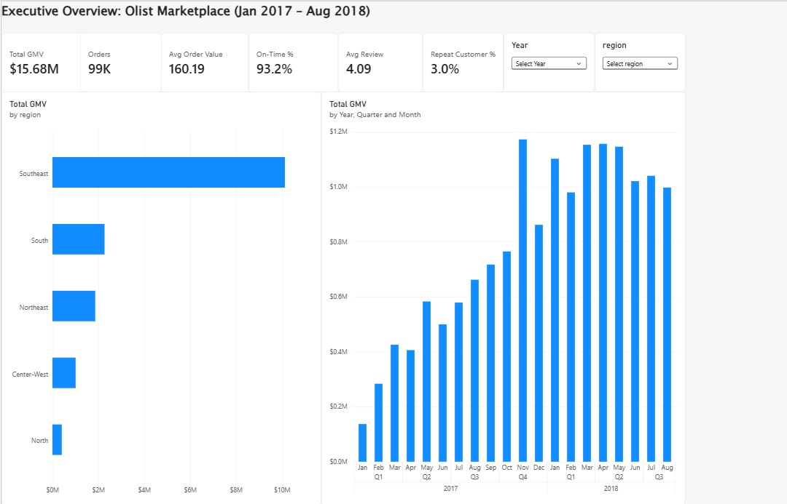
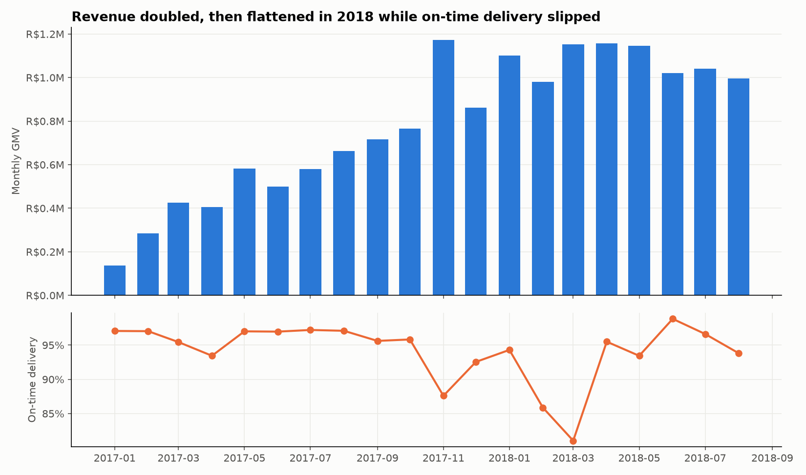
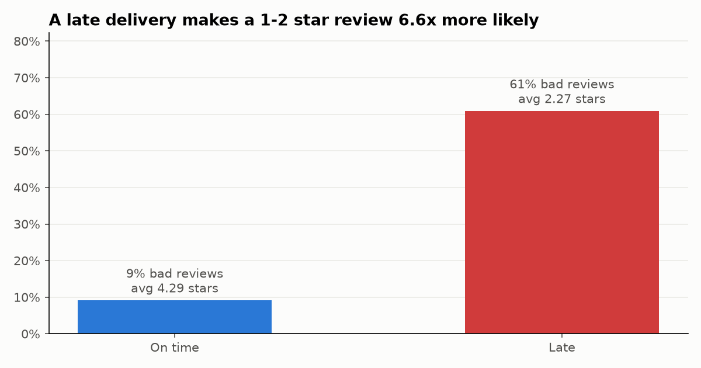
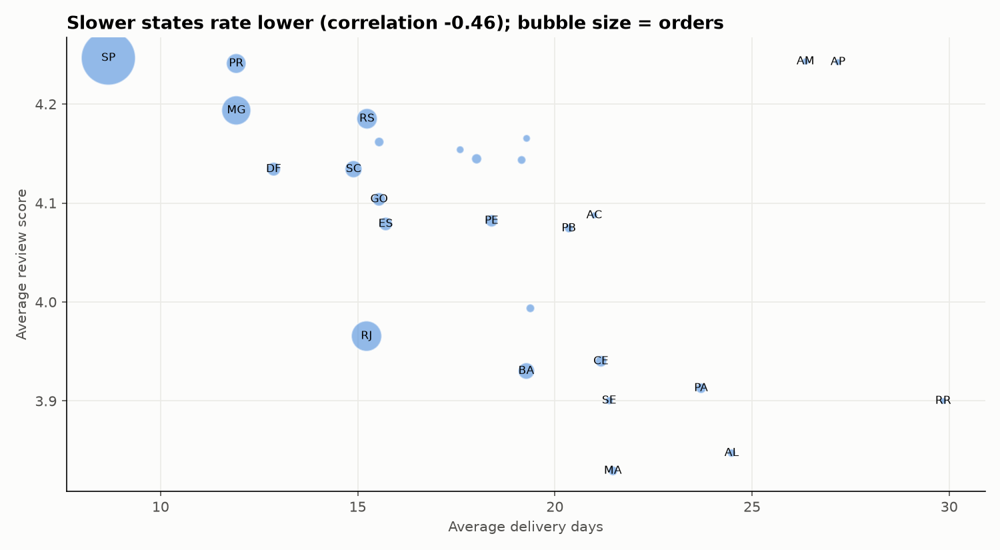
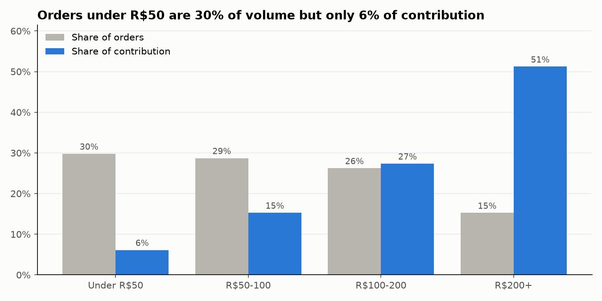
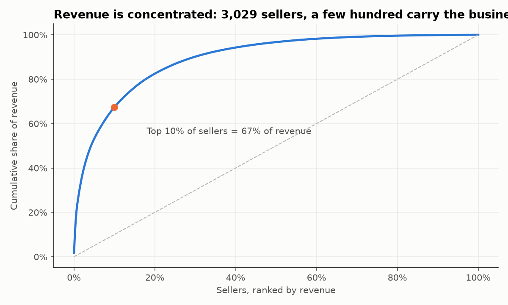
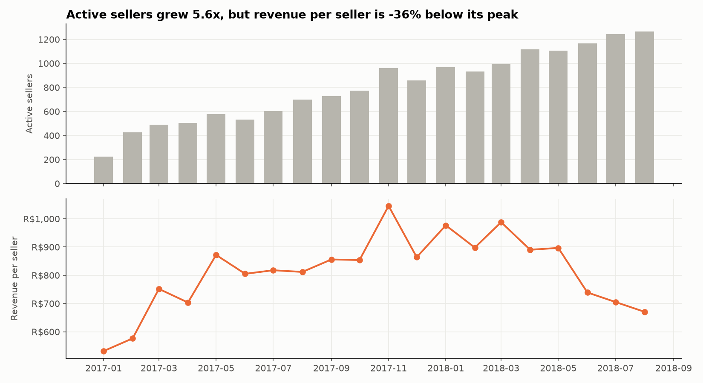
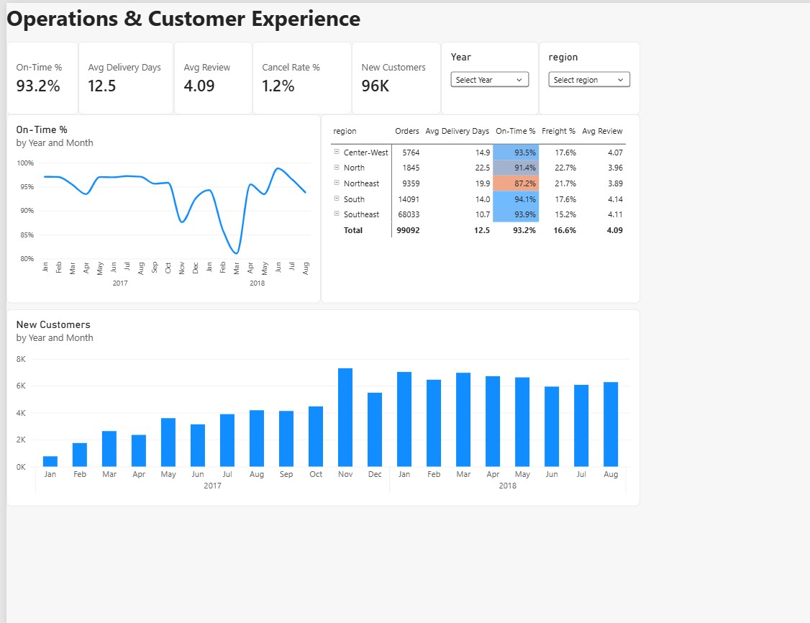
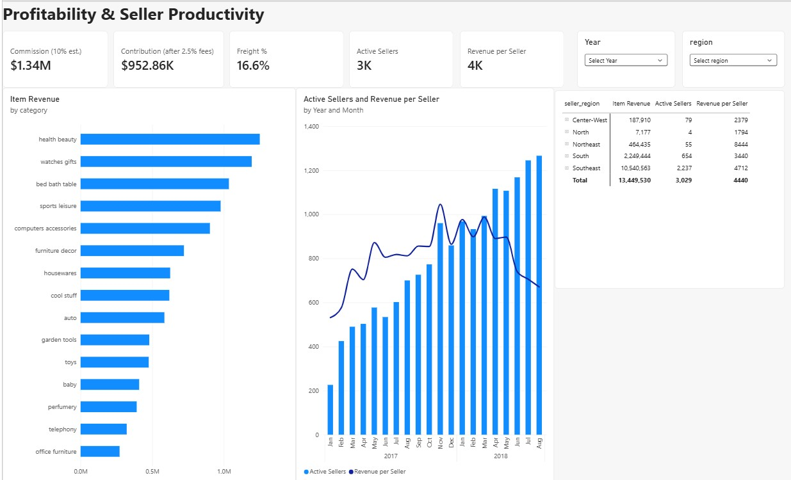

# Executive Business Performance & KPI Intelligence

**One unified view of sales, finance and operations for a Brazilian e-commerce marketplace, built with SQL, Python, Power BI and DAX on 1.5M+ rows of real Olist data.**

📊 **[View the full Power BI dashboard (PDF, 3 pages)](powerbi/Executive_KPI_Dashboard.pdf)**



---

## Business Problem

Olist is a Brazilian marketplace connecting thousands of small sellers to customers across the country. Its sales, payment, delivery, review and seller data sit in **8 separate tables**, so leadership has no single view of company performance. They asked:

1. **Growth:** Is the business still growing, and where does growth come from?
2. **Profitability:** Which orders and categories actually make money?
3. **Operations:** Is delivery keeping up with volume, and does it affect customers?
4. **Productivity:** Are sellers becoming more or less productive as the marketplace grows?

**Goal:** combine sales, finance and operational data into executive KPIs and a drill-down management report.

---

## Data

| Source | Description |
|---|---|
| **Kaggle** ([Brazilian E-Commerce Public Dataset by Olist](https://www.kaggle.com/datasets/olistbr/brazilian-ecommerce)) | 9 tables, about 1.55M rows: 99,441 orders, 112,650 items, 103,886 payments, 99,224 reviews, 3,095 sellers, 32,951 products (2016–2018) |

- **Reporting window:** Jan 2017 – Aug 2018 (20 full months, 99,092 orders). 2016 and Sep–Oct 2018 are incomplete and excluded from KPIs.
- **Currency:** Brazilian reais (R$).
- **Assumptions** (the data has no cost columns): Olist earns a **10% commission** on product price and pays **2.5% payment-processing fees** on order value. All profitability figures are labelled as estimates.

Licence: CC BY-NC-SA 4.0. Processed data is included for reproducibility, with attribution to Olist.

---

## Tools

| Tool | Used for |
|---|---|
| **SQL (DuckDB)** | Data validation, star-schema model, reconciliation, executive KPIs |
| **Python (pandas, matplotlib)** | KPI charts, export of the model for Power BI |
| **Power BI (service)** | Semantic model with 5 related tables, 3-page management report with drill-down filters |
| **DAX** | 19 measures: GMV, AOV, YoY growth, repeat rate, on-time %, contribution, seller productivity |

---

## Approach

1. **Validate (SQL):** checked keys, gaps and duplicates across 9 tables. Found and handled split payments (103,886 payments for 99,441 orders), per-order customer IDs (used `customer_unique_id`), 547 duplicate reviews, 610 uncategorised products and incomplete edge months.
2. **Model (SQL):** built a star schema with `fact_orders` (sales + finance + operations per order), `fact_items` (category and seller detail) and dimension tables. Aggregated payments, reviews and items **before** joining to avoid double counting. GMV reconciles exactly at order and item level (R$15,843,553).
3. **KPIs (SQL):** growth, loyalty, profitability, delivery performance and seller productivity.
4. **Charts (Python):** six charts that tell the story behind the KPIs.
5. **Report (Power BI + DAX):** 5-table model, 19 DAX measures **validated against the SQL results** (2018 GMV R$8,593,137 in both), and 3 report pages with Year → Quarter → Month and Region → State drill-downs, a Top-N category filter, synced slicers and cross-filtering.

---

## Executive Scorecard (Jan–Aug, same months each year)

| KPI | 2017 | 2018 | Change |
|---|---|---|---|
| Orders | 22,968 | 53,991 | **+135%** |
| GMV | R$3.57M | R$8.59M | **+140%** |
| Average order value | R$158 | R$161 | +1% |
| Customers | 22,320 | 52,743 | +136% |
| On-time delivery | 96.5% | 92.3% | **−4.2 pts** |
| Average review | 4.14 | 4.09 | down |
| Cancellation rate | 1.8% | 0.9% | better |

---

## Key Insights

**1. Revenue more than doubled, but growth has stalled.**
- GMV peaked on Black Friday (**Nov 2017, R$1.17M**) and has stayed flat at about **R$1.0–1.15M a month** through 2018.
- Year-on-year growth slowed from **+245% (Feb 2018)** to **+51% (Aug 2018)**.
- Growth came from **more orders, not bigger baskets** (AOV +1%).



**2. Customers almost never return.**
- Only **3.0%** of 94,707 customers ordered more than once; they bring **5.7%** of revenue.
- About **96% of each month's orders come from new customers**, so every real of growth must be bought through acquisition.

**3. Late delivery is the biggest driver of unhappy customers.**
- Only **6.8%** of orders arrive late, but **61%** of them get a 1–2 star review, against **9%** of on-time orders (**6.6× more likely**).
- Average review: **2.27 late vs 4.29 on time**.
- On-time delivery fell below 90% during the Nov 2017 peak and to about **81% in Mar 2018**.



**4. Service depends on where the customer lives.**
- **Southeast:** 10.7 days, 93.9% on time. **Northeast:** 19.9 days, **87.2%** on time, review 3.89.
- **Rio de Janeiro**, the #2 market, takes **15.2 days** with 87.9% on time.
- Slower states rate lower (correlation **−0.46** between delivery days and review score).



**5. Profit depends on order size, not category.**
- Contribution margin is **69–73%** of commission in every top category, so category mix is not the lever.
- Orders **under R$50** are **30% of orders** but earn only **R$2.00 each**, because freight equals **48.5%** of the product price. Orders over R$200 earn **R$32.69 each**.



**6. A few sellers carry the business, and each seller is earning less.**
- The **top 10% of sellers generate 67%** of revenue; the bottom half generate 3%.
- Active sellers grew **5.6×** (226 → 1,266 a month), but **revenue per seller fell 36%** from its Nov 2017 peak.




---

## Recommendations

| # | Recommendation | Expected impact |
|---|---|---|
| 1 | **Fix delivery in the Northeast and Rio de Janeiro** with regional carriers or fulfilment hubs, and plan extra capacity before peaks | Halving late deliveries would prevent about **1,700 bad reviews** in the period |
| 2 | **Launch a retention programme** (second-order vouchers, loyalty points) | Raising the repeat rate from 3% to 5% would add about **1,900 repeat customers**, about **R$300K GMV** at the current AOV |
| 3 | **Set a free-shipping threshold or bundle offers** to lift orders above R$50 | Moves volume from R$2 to R$5–10 contribution per order |
| 4 | **Create key-account management for the top 10% of sellers** | Protects **67% of revenue** from seller churn |
| 5 | **Shift from seller acquisition to seller activation** (training, promotion tools) | Reverses the **36% fall** in revenue per seller |

*Impacts 2 and 3 use the 10% commission / 2.5% fee assumptions and current averages.*

---

## Power BI Report

The report has **3 pages**, all filtered by synced **Year** and **Region** slicers:

| Page | What it shows | Drill-down |
|---|---|---|
| **Executive Overview** | GMV, orders, AOV, on-time %, review, repeat rate | Year → Quarter → Month, Region → State |
| **Operations** | On-time trend, regional scorecard with traffic-light colours, new customers | Region → State matrix |
| **Profitability & Sellers** | Commission, contribution, freight %, top 15 categories, seller productivity | Top-N categories, seller Region → State, cross-filtering |




**Example DAX measures**

```dax
Total GMV = CALCULATE ( SUM ( fact_orders[gmv] ), fact_orders[is_cancelled] = 0 )

GMV YoY % = DIVIDE ( [Total GMV] - [GMV LY], [GMV LY] )

Repeat Customer % =
DIVIDE (
    COUNTROWS ( FILTER ( VALUES ( fact_orders[customer_unique_id] ),
        CALCULATE ( COUNTROWS ( fact_orders ), fact_orders[is_cancelled] = 0 ) > 1 ) ),
    [Customers]
)

Contribution = [Commission] - [Payment Fees]
```

---

## Repository Structure

```
Executive-KPI-Intelligence/
├── data/
│   ├── raw/            # Olist CSVs (downloaded by 00_get_data.py, not stored)
│   └── processed/      # fact_orders.csv, fact_items.csv, dim_sellers.csv
├── sql/
│   ├── 01_load_and_quality_check.sql
│   ├── 02_build_model.sql
│   ├── 03_growth_kpis.sql
│   └── 04_profit_ops_productivity.sql
├── python/
│   ├── 00_get_data.py              # downloads the Kaggle data
│   ├── run_sql.py                  # runs a .sql file against DuckDB
│   ├── 01_kpi_charts.py            # 6 executive charts
│   └── 02_export_for_powerbi.py    # star schema to Excel for Power BI
├── powerbi/
│   ├── executive_kpi_model.xlsx    # model data loaded into Power BI
│   └── Executive_KPI_Dashboard.pdf # the 3-page report
├── images/
└── README.md
```

---

## How to Run

```bash
pip install kagglehub pandas numpy matplotlib duckdb openpyxl
python python/00_get_data.py
python python/run_sql.py sql/01_load_and_quality_check.sql
python python/run_sql.py sql/02_build_model.sql
python python/run_sql.py sql/03_growth_kpis.sql
python python/run_sql.py sql/04_profit_ops_productivity.sql
python python/01_kpi_charts.py
python python/02_export_for_powerbi.py
```

Then upload `powerbi/executive_kpi_model.xlsx` to Power BI, create the relationships and add the DAX measures.

---

## What I Learned

- **Aggregate before you join.** Joining raw payments to items multiplies rows and double-counts revenue; reconciling GMV at two levels proved the model was right.
- **Validate the BI layer against SQL.** Every DAX measure was checked against an independent SQL result before building visuals.
- **Executives need connected stories, not separate KPIs.** Growth, delivery and reviews are one story: volume grew, delivery slipped, and satisfaction followed.
- **Label assumptions.** Profitability uses estimated commission and fees, stated on the dashboard itself.

---

**Abrar Ahmed Syed** · [LinkedIn](https://www.linkedin.com/in/abrar313) · [Portfolio](https://abuabrar09.github.io) · [GitHub](https://github.com/Abuabrar09)
